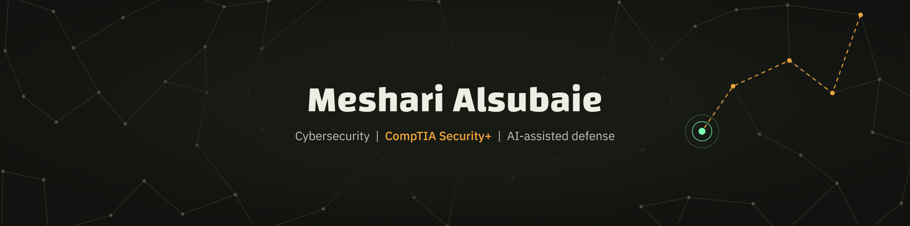

Computer science student at Taif University, heading into cybersecurity. CompTIA Security+ certified.

I build defensive systems end to end, and I use AI where it helps and fence it in where it can hurt.

## Projects

### [Rasid](https://github.com/meshare-alsubaie/rasid-3)
Watches 146 Saudi organizations across 283 sources and alerts students on Telegram and a web app when a co-op training program opens, changes, or is about to close. A fast model reads each announcement and a second model confirms before anything is sent. Runs unattended on GitHub Actions, covered by 289 automated tests.
 Python, JavaScript, GitHub Actions, Gemini API, Cloudflare Workers. [Live site](https://meshare-alsubaie.github.io/rasid-3/)

### Haris
An AI-assisted security operations center, built as my graduation project with a team of five; I designed the system and built most of it. In an isolated lab, Haris detects an attack, a local language model analyses it, and the source is isolated automatically. Mean time to detect 1.51 s and mean time to respond 10.2 s in live runs. Prompt injection hidden in logs succeeded in 12 of 12 attempts before hardening and 0 of 12 after.
 Wazuh, Zeek, Suricata, OPNsense, Open vSwitch, Docker, Ollama (Llama 3.1 8B), Python. University project, not public.

### Nabra (in progress)
An offline audio mixer for Windows with per-app mixing and AI noise suppression. The interface prototype is built; the audio engine is in development.
 C#, .NET, WASAPI, ONNX Runtime.

## Now

Looking for a co-op training placement in cybersecurity from January 2027, anywhere in Saudi Arabia.
